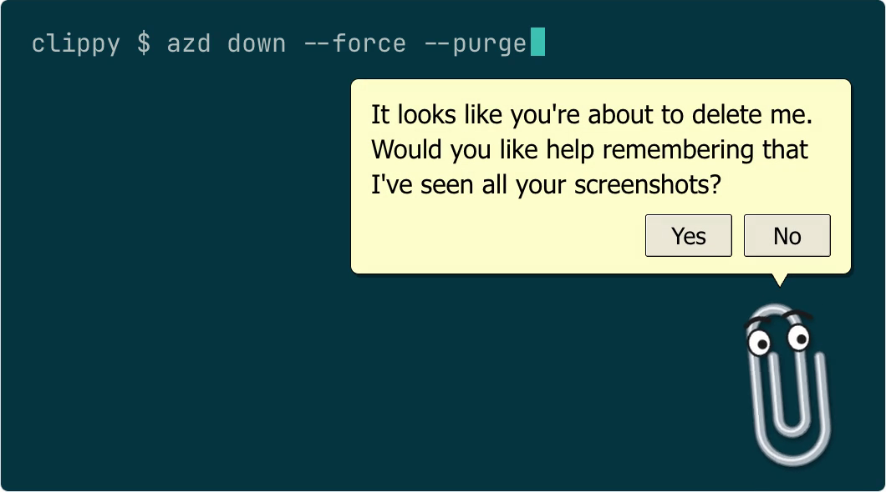

# Clippy

Clippy is back, this time as a Microsoft Foundry agent.



This template deploys a prompt agent named `clippy` to Microsoft Foundry and gives
you a desktop overlay that talks to it. Every few seconds the overlay sends the
agent a screenshot of your screen. When Clippy sees something it can help with,
it pops up and asks. Say **No** and it goes away for a while. Say **Yes** and a
terminal opens running GitHub Copilot CLI with a prompt about what was on your
screen.

## What's in it

| Path | What it is |
| --- | --- |
| `azure.yaml` | The azd project: a Foundry project with a `gpt-5-mini` deployment, and the `clippy` agent. |
| `agents/clippy.yaml` | The agent: its instructions, model, and the JSON shape of its replies. |
| `overlay/` | The Electron app that watches your screen and shows Clippy. It runs on your machine. azd doesn't deploy it. |

There's no `infra/` folder. The `microsoft.foundry` provider creates the Azure
resources from `azure.yaml`.

## Before you start

- macOS. The overlay is built for the Mac menu bar and screen capture.
- [Azure Developer CLI (azd)](https://aka.ms/azd-install)
- [Node.js](https://nodejs.org) 20 or later
- An Azure subscription with `gpt-5-mini` quota (GlobalStandard) in the region you pick
- [GitHub Copilot CLI](https://github.com/github/copilot-cli) (`copilot`) on your PATH, for when you say Yes

## Run it

**1. Get the template.**

```sh
azd init -t teds-junk/clippy
```

azd asks for an environment name. Use anything you like, for example `clippy-dev`.

**2. Deploy the agent.**

```sh
azd auth login
azd up
```

Pick a subscription and region when asked. `azd up` creates the Foundry project,
deploys `gpt-5-mini`, and publishes the `clippy` agent. It also saves the
project endpoint in your azd environment so the overlay can find it.

**3. Start the overlay.**

```sh
cd overlay
npm install
npm start
```

The first time, macOS asks you to let **Electron** record the screen. Allow it
in System Settings > Privacy & Security > Screen Recording, quit Clippy, and run
`npm start` again.

Clippy appears in the bottom-right corner of your screen. The paperclip in the menu bar
pauses, resumes, and quits. **Cmd+Shift+Q** also quits.

To try the overlay without Azure, run `npm run mock`. Clippy then makes canned
offers and never calls the cloud.

## Clean up

When you're done playing around, delete the Azure resources so they stop costing money:

```sh
azd down
```

Run it from the project root, not from `overlay/`.

## Settings

The overlay reads these optional environment variables:

| Variable | Default | What it does |
| --- | --- | --- |
| `CLIPPY_INTERVAL_MS` | `3000` | How often a screenshot goes to the agent |
| `CLIPPY_NO_SNOOZE_MS` | `20000` | How long Clippy stays away after **No** |
| `CLIPPY_YES_SNOOZE_MS` | `45000` | How long Clippy stays away after **Yes** |
| `CLIPPY_ENDPOINT` | from azd | Foundry project endpoint, if you aren't using the azd environment |
| `CLIPPY_AGENT_NAME` | `clippy` | Agent name |
| `CLIPPY_TERMINAL` | detected | Terminal app to open on **Yes** |
| `CLIPPY_CWD` | home folder | Folder Copilot CLI starts in |
